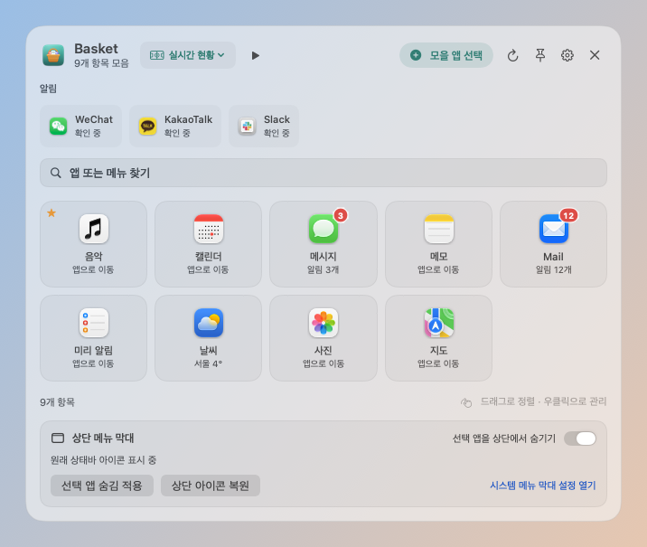
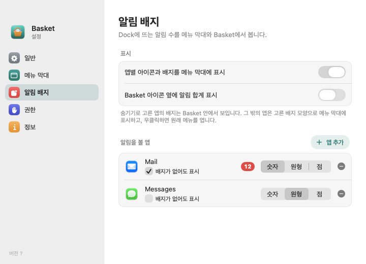

# Basket

Basket은 자주 쓰는 메뉴 막대 앱을 한곳에 모아 상단 공간을 정리하는 macOS 앱입니다. 바구니 아이콘을 클릭하거나 **⌥⌘B**를 누르면 앱 목록과 알림 배지를 함께 볼 수 있습니다.

[다운로드](#다운로드) · [화면 미리보기](#화면-미리보기) · [처음 설정하기](#처음-설정하기) · [문제 해결](#문제-해결)

## 다운로드

**Basket 0.7.2 (빌드 42)** · macOS 13 이상 · Apple Silicon 및 Intel용 유니버설 빌드

| 파일 | 용도 | SHA-256 |
| --- | --- | --- |
| [DMG](https://github.com/jiwoo-0929/Basket/releases/download/basket-v0.7.2/Basket-0.7.2-macOS-universal.dmg) | 설치 이미지를 열어서 설치 | [DMG 체크섬](https://github.com/jiwoo-0929/Basket/releases/download/basket-v0.7.2/Basket-0.7.2-macOS-universal.dmg.sha256) |
| [ZIP](https://github.com/jiwoo-0929/Basket/releases/download/basket-v0.7.2/Basket-0.7.2-macOS-universal.zip) | 압축을 푼 뒤 설치 | [ZIP 체크섬](https://github.com/jiwoo-0929/Basket/releases/download/basket-v0.7.2/Basket-0.7.2-macOS-universal.zip.sha256) |

두 파일은 같은 앱 빌드를 담고 있습니다. [0.7.2 릴리스 노트](https://github.com/jiwoo-0929/Basket/releases/tag/basket-v0.7.2)

## 주요 기능

- **앱 모음과 검색** — 선택한 앱 카드만 표시합니다. 이름으로 검색하고, 카드를 끌어 순서를 바꾸거나 즐겨찾기에 추가할 수 있습니다.
- **앱과 원래 메뉴 열기** — 카드를 누르면 해당 앱이나 메뉴를 엽니다. 카드의 우클릭 메뉴에서 원래 메뉴 열기와 관리 옵션을 사용할 수 있습니다.
- **메뉴 막대 숨김과 복원** — 선택한 앱의 상단 아이콘을 숨기고 필요할 때 다시 표시합니다. 세부 동작은 macOS 버전에 따라 다릅니다.
- **앱별 알림 배지** — Dock이 제공하는 배지를 숫자·원형·점으로 표시합니다. Basket 아이콘 옆에 알림 합계를 표시할 수도 있습니다.
- **실시간 현황과 재생 제어** — 헤더에서 표시할 실시간 현황 한 개를 고르고 macOS 재생 제어를 엽니다. macOS가 제공하는 항목과 화면 정보에 따라 표시가 달라집니다.

## 화면 미리보기

아래는 이전 버전의 예시 화면입니다. 세부 문구와 메뉴 막대 동작은 사용 중인 macOS와 Basket 버전에 따라 다를 수 있습니다.



선택한 앱과 알림을 한 패널에서 봅니다.



설정에서 배지를 표시할 앱과 모양을 고릅니다.

## 설치

1. **DMG**를 열거나 **ZIP** 전체를 풉니다.
2. 업데이트하는 경우 실행 중인 Basket을 종료합니다. **Basket.app**을 **응용 프로그램** 폴더로 옮기고 그곳에서 실행합니다.
3. 메뉴 막대의 바구니 아이콘 또는 **⌥⌘B**로 Basket을 엽니다. 패널의 톱니바퀴에서 **Basket 설정**을 열 수 있습니다.

Apple Development 인증서로 서명한 미공증 배포판입니다. 다운로드 직후 Gatekeeper가 첫 실행을 차단할 수 있습니다.

### 체크섬 확인

설치 파일과 대응하는 체크섬 파일을 같은 폴더에 둡니다. 터미널에서 해당 폴더를 연 뒤 다운로드한 형식의 명령을 실행합니다. 일치하면 파일 이름 옆에 **OK**가 표시됩니다.

```bash
shasum -a 256 -c Basket-0.7.2-macOS-universal.dmg.sha256
shasum -a 256 -c Basket-0.7.2-macOS-universal.zip.sha256
```

## 처음 설정하기

1. **권한 확인** — **Basket 설정 → 권한**에서 손쉬운 사용을 허용합니다. 메뉴 막대 항목과 Dock 배지를 읽고 원래 메뉴를 열 때 필요합니다. 실시간 현황과 배지의 원본 이미지를 보려면 **화면 기록**도 허용합니다.
2. **앱 선택** — 패널의 **모을 앱 선택**에서 앱을 고른 뒤 **선택 적용**을 누릅니다. 목록에 앱이 보이지 않으면 앱을 먼저 실행하고 Basket에서 새로고침합니다.
3. **순서와 실행 방식** — 카드를 끌어 순서를 바꿉니다. 우클릭으로 원래 메뉴 열기, 즐겨찾기, 모음에서 빼기를 사용합니다. 패널을 계속 띄우려면 헤더의 핀을 누릅니다.
4. **배지와 로그인 실행** — **알림 배지**에서 앱을 추가하고 표시 모양과 빈 배지 표시 여부를 고릅니다. **일반**에서는 로그인할 때 자동 실행할지 정합니다.

## 메뉴 막대 숨김과 복원

| macOS | 숨기기 | 다시 표시하기 |
| --- | --- | --- |
| **27 이상** | **선택 앱을 상단에서 숨기기**를 켜고 선택을 적용합니다. 이미 골라 둔 앱에는 **선택 앱 숨김 적용**을 누릅니다. macOS의 앱별 메뉴 막대 스위치를 사용합니다. | 앱을 선택 해제하거나 **상단 아이콘 복원**을 누릅니다. **시스템 메뉴 막대 설정 열기**에서 개별 앱의 표시 상태를 확인할 수 있습니다. |
| **13–26** | 구분선 뒤에 배치된 선택 앱을 접습니다. 배치가 필요하면 접기 메뉴의 **한 번 자동 배치**를 사용합니다. | **잠시 펼치기**, 메뉴 막대 Basket 아이콘의 **⌥클릭**, 또는 기본 **⌥⇧⌘B**로 펼칩니다. **계속 펼쳐 두기**는 열린 상태를 유지합니다. |

macOS 27 이상에서는 앱별 숨김을 적용할 때 시스템 설정이 잠시 열릴 수 있습니다. 앱별 숨김 상태는 Basket을 종료해도 유지됩니다. 종료 전에 원래 아이콘을 다시 표시하려면 **상단 아이콘 복원**을 사용합니다.

macOS 26 이하에서는 기본 10초 후 다시 접힙니다. **Basket 설정 → 메뉴 막대**에서 시간을 조정하거나 자동 접기를 끌 수 있습니다. 자동 배치 중 직접 마우스나 키보드를 사용하면 배치가 중단됩니다.

## 알림 배지와 실시간 현황

- **알림 배지**에서 앱별 배지와 Basket 합계 표시를 켭니다. 앱이 아직 Dock에 값을 제공하지 않으면 **확인 중**으로 보일 수 있습니다. 상단에서 숨기기로 선택한 앱의 배지는 Basket 안에서 봅니다.
- Basket 이름 옆 **실시간 현황**에서 표시할 항목 하나를 고릅니다. macOS가 위치를 고정한 실시간 현황 원본은 상단에 남습니다.
- 화면 기록 권한은 원본 점수와 배지 이미지를 읽을 때 사용합니다. 메뉴 읽기와 Dock 배지 수 확인은 손쉬운 사용이 담당합니다.

## 문제 해결

| 증상 | 확인할 곳 |
| --- | --- |
| **권한을 켰는데 Basket에서 필요하다고 표시됨** | 응용 프로그램 폴더의 Basket을 실행했는지 확인합니다. 계속되면 macOS 손쉬운 사용 목록에서 Basket을 제거한 뒤 같은 설치본을 다시 추가합니다. |
| **앱 카드나 원래 메뉴가 보이지 않음** | 해당 앱을 실행하고 Basket의 새로고침을 누릅니다. 카드가 보인다면 우클릭에서 원래 메뉴를 확인합니다. 앱이 해당 메뉴 막대 항목과 열기 동작을 제공해야 합니다. |
| **원래 상단 아이콘을 되돌리고 싶음** | macOS 27 이상은 **상단 아이콘 복원**을 사용합니다. macOS 26 이하는 **계속 펼쳐 두기**를 선택합니다. 한 앱만 빼려면 **모을 앱 선택**에서 해당 앱을 해제합니다. |
| **macOS 26에서 새 아이콘이 사라진 뒤에도 계속 펼쳐짐** | 0.7.2에서 확인된 증상입니다. **계속 펼쳐 두기**로 원래 아이콘을 사용하고, 메뉴 막대가 안정된 뒤 접기 동작을 다시 시도합니다. |
| **노치 주변이나 다른 화면에서 보이는 아이콘이 다름** | macOS 26 이하에서는 **Basket 설정 → 메뉴 막대**의 노치 보조줄 옵션을 확인합니다. macOS 27에서는 개별 메뉴 막대 창을 읽을 수 있는 범위가 줄어 보조줄과 원본 이미지 표시에 제한이 있습니다. |

## 0.7.2 검증 범위

배포 DMG와 ZIP의 체크섬, 두 설치 파일의 앱 일치, 코드 서명, Apple Silicon·Intel 아키텍처를 확인했습니다. Apple Silicon의 macOS 26.6.2 가상 Mac에서는 선택 숨김·복원, 30회 연속 선택 변경, 10초 자동 접기, 원래 메뉴 열기와 시험 앱의 배지 갱신을 확인했습니다. 새 미선택 아이콘이 나타난 뒤 자동 재접기가 멈추는 경우도 재현됐습니다. Intel 실기와 여러 화면 조합에 대한 실행 검증은 남아 있습니다. [릴리스 검증 및 제한 사항](https://github.com/jiwoo-0929/Basket/releases/tag/basket-v0.7.2)
